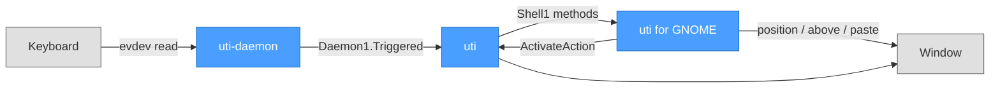
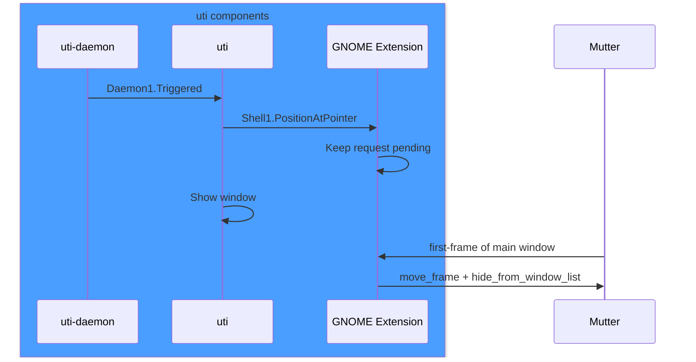

# Architecture

This document describes the architecture of uti across different platforms and configurations.

## Overview

uti is a clipboard manager and app launcher that is invoked by pressing Ctrl twice quickly. Due to platform security restrictions (especially on Wayland), a multi-component architecture is required on Linux.

The app owns state; the daemon and the extension are services it calls.

## Requirements

- **Linux** with D-Bus session bus and glibc
- **systemd** for daemon service management
- User in `input` group for keyboard and mouse access

**Optional**: "uti for GNOME" extension enables the panel menu, cursor positioning, always-on-top, hiding from dash / Alt+Tab, and paste on **GNOME/Wayland**. Without it, window appears at screen center and pin button only disables auto-hide.

---

## Components

### uti-daemon

Rust daemon that monitors keyboards and mice, detects double Ctrl press and left
double clicks, and provides virtual keyboard for auto-paste functionality.

| Property | Value |
| -------- | ----- |
| Language | Rust |
| Input | evdev (`/dev/input/event*`, hotplug via inotify) |
| Output | `Daemon1` signals, uinput (`/dev/uinput`: keyboard, mouse mirrors) |
| Permissions | `input` group membership |
| Service | `uti-daemon.service` (systemd user) |

A tap is a short Ctrl press with no other key in between; two taps within
300 ms trigger (`daemon/src/detector.rs`). Two left presses within 400 ms are a
double click (`daemon/src/click.rs`), wherever the pointer is.

While the app enables `SetMouseGrab`, mice with buttons and relative motion (not
touchpads) are grabbed (`EVIOCGRAB`) and re-emitted through a uinput mirror
("uti Virtual Mouse", same ids), minus the right press/release of a left-held +
right click (`daemon/src/mouse.rs`). The grab is released when the app leaves
the bus or a mirror write fails.

### uti (GTK App)

Main application with Clipboard, Snippets and Launcher tabs, plus a settings window.

| Property | Value |
| -------- | ----- |
| Toolkit | Rust + gtk4-rs 0.11 + libadwaita 0.9 (`app/`) |
| Structure | `app.rs` controller (`Msg` loop), `ui.rs`, `dbus.rs`, `settings.rs`, `state/` (pure UI logic), `config/` `clipboard/` `snippets/` `launcher/` (data files) |
| IPC | D-Bus: owns `io.github.noppomario.uti`, serves `ActivateAction`, calls `Shell1` / `Daemon1` |
| Config | `~/.config/uti/config.json` |
| Launcher | `~/.config/uti/launcher.json` |
| Clipboard | `~/.local/share/uti/clipboard.json` (moved from `~/.config/uti/` on first start) |
| Snippets | `~/.config/uti/snippets.json` |

**Snippets Feature:**

- Added from Clipboard rows (context menu or `S`); history items stay, duplicates allowed
- Row context menus: one `gtk::PopoverMenu` parented to the stack, items from `state/menu.rs`,
  actions in the window's `row` group. While it is open, the window's key and focus handlers
  leave it alone (it lives in the window's widget tree); it does not drop window focus
- Managed in Settings > Snippets (list -> editor); the main window owns the store and
  re-renders the settings list after each change. Manual editing via JSON file supported

**Launcher Features:**

- Configurable application commands and installed app search (`gio::AppInfo`) with keyboard navigation
- Jump lists showing recent files from system history (recently-used.xbel)
- VSCode recent files support via SQLite database

### uti for GNOME

GNOME Shell extension that provides:

1. **Panel menu** - Show/Hide, Settings, Check for Updates, GitHub, Quit (calls the app's `ActivateAction`)
2. **Cursor positioning** - Moves the main window to the pointer on its first frame
3. **Always-on-top** - `Meta.Window.make_above()` (Mutter ignores app-level requests on Wayland)
4. **Hide from dash / Alt+Tab** - `Meta.Window.hide_from_window_list()`
5. **Paste** - Clutter virtual keyboard after focus leaves uti
6. **Clipboard watch** - `Meta.Selection` owner changes, emitted as `ClipboardChanged`
7. **Shell clicks** - presses on the desktop background or panel (which do not move focus), emitted as `ShellPressed` while the main window is shown
8. **Desktop hit test** - `PointerOnDesktop`: whether the pointer is over the background or a desktop-type window
9. **Background press blocking** - `SetBlockBackgroundPress`: stops left presses on the background (GNOME's long-press menu) until the app leaves the bus

| Property | Value |
| -------- | ----- |
| UUID | `uti@noppomario.github.io` |
| Settings | GSettings (`org.gnome.shell.extensions.uti`) |
| Shell versions | 50, 51 |

---

## Linux: GNOME + Wayland (Primary)

The recommended configuration for GNOME desktop.

### Toggle Window Sequence

---

## D-Bus Interfaces

| Owner | Bus name | Object path | Interface | Members |
| ----- | -------- | ----------- | --------- | ------- |
| uti-daemon | `io.github.noppomario.uti.Daemon` | `/io/github/noppomario/uti/Daemon` | `io.github.noppomario.uti.Daemon1` | signals `Triggered()`, `DoubleClicked()`, `LeftRightClicked()`, methods `Paste(b plain, b submit)`, `SetMouseGrab(b)` |
| uti | `io.github.noppomario.uti` | `/io/github/noppomario/uti` | `org.freedesktop.Application` | `ActivateAction(s, av, a{sv})`: `toggle`, `show`, `hide`, `settings`, `check-updates`, `quit` |
| GNOME Extension | `io.github.noppomario.uti.Shell` | `/io/github/noppomario/uti/Shell` | `io.github.noppomario.uti.Shell1` | `PositionAtPointer(b activate)`, `SetAbove(b)`, `Paste(b plain, b submit)`, `PointerOnDesktop() -> b`, `SetBlockBackgroundPress(b)`, signals `ClipboardChanged(s)`, `ShellPressed()` |

All `Daemon1` and `Shell1` methods reject callers that do not own
`io.github.noppomario.uti` (`AccessDenied`). Nothing in the app calls `Paste`
since the Prompt tab was removed.

The popup hides on outside clicks unless pinned: clicks on app windows arrive
as focus loss, clicks on the Shell itself as `ShellPressed` (ADR-035).
With `mouse.desktopDoubleClick`, a hidden app answers `DoubleClicked` by asking
`PointerOnDesktop` and shows if true; `ShellPressed` within 500 ms of showing is
ignored. With `mouse.leftRightClick`, the app calls `SetMouseGrab` and
`SetBlockBackgroundPress` whenever either service appears, and opens the
Launcher at the pointer on `LeftRightClicked`. Mouse triggers open the Launcher
tab, everything else the Clipboard tab.

---

## File Locations

| File | Purpose |
| ---- | ------- |
| `/usr/bin/uti` | Main application |
| `/usr/bin/uti-daemon` | Keyboard daemon |
| `/usr/lib/udev/rules.d/99-uti-uinput.rules` | uinput access for auto-paste |
| `/usr/lib/systemd/user/uti-daemon.service` | Daemon service (enabled per user) |
| `~/.config/uti/config.json` | User configuration |
| `~/.config/uti/launcher.json` | Launcher commands |
| `~/.local/share/uti/clipboard.json` | Clipboard history |
| `~/.config/uti/snippets.json` | Pinned snippets |
| `/usr/share/gnome-shell/extensions/uti@noppomario.github.io/` | GNOME extension |
| `/usr/share/glib-2.0/schemas/org.gnome.shell.extensions.uti.gschema.xml` | Extension settings schema |
