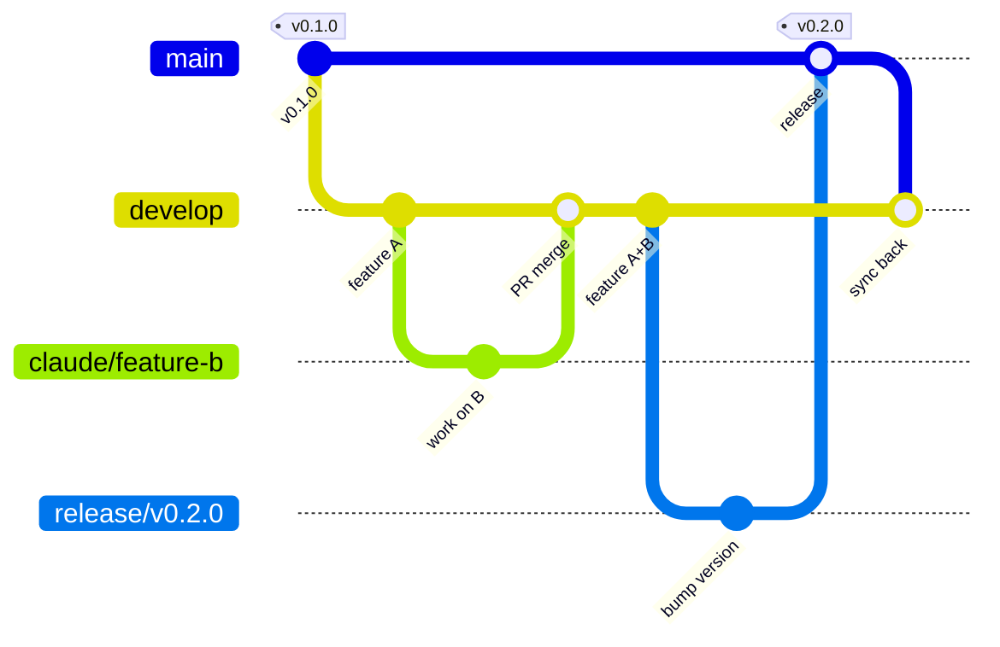

# Development Environment Setup

Complete setup guide for developing **uti** on Fedora 44.

---

## Prerequisites

- **OS**: Fedora 44 (GNOME 50/Wayland). Ubuntu cannot build the app (no libadwaita 1.9); CI builds in a `fedora:44` container.
- **Rust**: Install via [mise](https://mise.jdx.dev/) or [rustup](https://rustup.rs/)
- **Bun**: Install via [mise](https://mise.jdx.dev/) or [bun.sh](https://bun.sh/)
- **Rust components**: `rustfmt`, `clippy`

---

## System Dependencies

```bash
sudo dnf install -y cargo gcc gtk4-devel libadwaita-devel rpm-build
```

`rpm-build` is only needed for packaging.

---

## Architecture

For architecture documentation with diagrams, see [ARCHITECTURE.md](ARCHITECTURE.md).

---

## Project Setup

```bash
# Clone repository
git clone https://github.com/noppomario/uti.git
cd uti

# Install task runner dependencies
bun install

# Build (first build takes a few minutes)
cargo build --workspace --release
```

---

## Verification

```bash
# Run full CI checks locally (lint, test, build)
bun run ci:local
```

---

## Development Workflow

### Initial Setup (one-time)

Add your user to `input` group to access keyboard devices:

```bash
sudo usermod -a -G input $USER
```

**Important**: Logout and login again for group membership to take effect.

Verify group membership:

```bash
groups
# Should include "input"
```

### Running the Application

```bash
# Terminal 1: Run daemon (no sudo needed after group setup)
cd daemon
cargo run

# Terminal 2: Run app
bun run app:run   # ./app/run-dev.sh [--reset]
```

`app/run-dev.sh` runs the app against a sandbox copy of `~/.config/uti` under `target/uti-dev` (`--reset` recreates it). It sets `UTI_DEV_SANDBOX=1` so apps launched from uti get the real XDG dirs. Stop the installed uti first: only one instance can own the bus name.

### Debug Aids

- `UTI_DEBUG_SNAPSHOT=file.png`: render the main or settings window to PNG after it is shown
- `UTI_DEBUG_KEYS=1`: add a `debug-key` action that injects a key press:

```bash
gdbus call --session -d io.github.noppomario.uti -o /io/github/noppomario/uti \
  -m org.freedesktop.Application.ActivateAction debug-key '[<"right">]' '{}'
```

### Why input group?

- Daemon needs to read `/dev/input/event*` (keyboard devices)
- These devices are owned by `root:input` with `660` permissions
- Adding user to `input` group grants read access
- This is the standard Linux approach (similar to `docker`, `audio` groups)
- **Reversible**: Remove with `sudo gpasswd -d $USER input`
- **Required for both development and production** - The daemon runs as a user
  session service, not as root

---

## Troubleshooting

### "gtk4" or "libadwaita-1" not found by pkg-config

```bash
sudo dnf install gtk4-devel libadwaita-devel
```

### "permission denied" when running daemon

Daemon needs access to `/dev/input/*` devices.

**Solution**: Add user to `input` group (see Development Workflow section above):

```bash
sudo usermod -aG input $USER
# Log out and log back in, then:
cargo run  # No sudo needed
```

### Slow first build

First Rust build downloads and compiles all dependencies (a few minutes).
Subsequent builds are much faster (<30 seconds for small changes).

---

## IDE Setup (VSCode)

Recommended extensions (listed in `.vscode/extensions.json`):

- **Biome**: GNOME extension JavaScript linting and formatting
- **rust-analyzer**: Rust language support

Settings (`.vscode/settings.json`) are pre-configured:

- Format on save: Enabled
- Biome for JavaScript
- rust-analyzer for Rust

---

## Release Process

### Version Update

Update version in all 6 locations:

| File | Format |
| ---- | ------ |
| `package.json` (root) | `"version": "X.Y.Z"` |
| `app/Cargo.toml` | `version = "X.Y.Z"` |
| `app/packaging/uti.spec` | `Version:        X.Y.Z` |
| `daemon/Cargo.toml` | `version = "X.Y.Z"` |
| `daemon/uti-daemon.spec` | `Version:        X.Y.Z` |
| `crates/uti-core/Cargo.toml` | `version = "X.Y.Z"` |

**Note**: All components share the same version number for unified releases.

### Branch Strategy



- `main`: Stable releases only (protected)
- `develop`: Latest development (feature PRs merge here)
- `claude/*`: Feature branches

### Creating a Release

1. Ensure `develop` has all features for release
2. Run the release workflow:

   ```bash
   gh workflow run release.yml -f version=X.Y.Z
   ```

3. GitHub Actions will automatically:
   - Create release branch from `develop`
   - Bump version in all locations
   - Create PR to `main` with auto-merge
   - Create tag when PR merges
   - Build and publish release artifacts
   - Sync `main` back to `develop`

### Manual Tag Push (Alternative)

For manual control, you can still create a tag directly:

```bash
git tag vX.Y.Z
git push origin vX.Y.Z
```

This triggers only the build and release jobs (skips version bump).

### Release Artifacts

Each release includes:

- `uti-X.Y.Z-1.x86_64.rpm` - GTK application
- `uti-daemon-X.Y.Z-1.x86_64.rpm` - Keyboard daemon
- `gnome-extension.zip` - GNOME Shell extension (uti for GNOME)

---

## Additional Resources

- [gtk4-rs book](https://gtk-rs.org/gtk4-rs/stable/latest/book/)
- [Project Memory](../CLAUDE.md)
- [Code Conventions](../.claude/rules/conventions.md)
- [Architectural Decisions](../.claude/rules/decisions.md)
