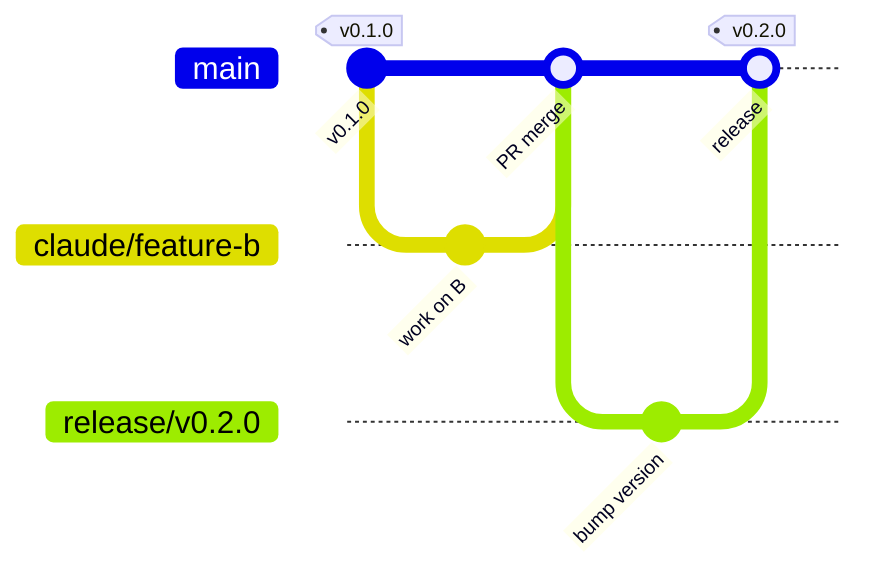

# Development Environment Setup

Complete setup guide for developing **uti** on Fedora 44.

---

## Prerequisites

- **OS**: Fedora 44 (GNOME 50/Wayland). Ubuntu cannot build the app (no libadwaita 1.9); CI builds in a `fedora:44` container.
- **Rust**: Install [rustup](https://rustup.rs/); `rust-toolchain.toml` pins the version (Fedora 44's rust, used by COPR/RPM builds) with `rustfmt` and `clippy`
- **mise**: Install [mise](https://mise.jdx.dev/); `mise.toml` + `mise.lock` pin just, lefthook, biome, cargo-deny, rumdl, git-cliff and actionlint

---

## System Dependencies

```bash
sudo dnf install -y cargo gcc gtk4-devel libadwaita-devel rpm-build
```

`rpm-build` is only needed for packaging.

---

## Architecture

For architecture documentation with diagrams, see [ARCHITECTURE.md](ARCHITECTURE.md).

---

## Project Setup

```bash
# Clone repository
git clone https://github.com/noppomario/uti.git
cd uti

# Install pinned tools and Git hooks
mise install
just setup

# Build (first build takes a few minutes)
cargo build --workspace --release
```

---

## Verification

```bash
# Same checks as CI: lint, cargo-deny, test
just ci
```

Other recipes: `just fmt`, `just lint`, `just test`, `just rpm` (see `justfile`). Git hooks (`lefthook.yml`) format staged files on commit, enforce Conventional Commits and run `just lint-rust test` on push; skip once with `LEFTHOOK=0`.

---

## Development Workflow

### Initial Setup (one-time)

Add your user to `input` group to access keyboard devices:

```bash
sudo usermod -a -G input $USER
```

**Important**: Logout and login again for group membership to take effect.

Verify group membership:

```bash
groups
# Should include "input"
```

### Running the Application

```bash
# Terminal 1: Run daemon (no sudo needed after group setup)
cd daemon
cargo run

# Terminal 2: Run app
just run          # ./app/run-dev.sh [--reset]
```

`app/run-dev.sh` runs the app against a sandbox copy of `~/.config/uti` under `target/uti-dev` (`--reset` recreates it). It sets `UTI_DEV_SANDBOX=1` so apps launched from uti get the real XDG dirs. Stop the installed uti first: only one instance can own the bus name.

### Debug Aids

- `UTI_DEBUG_SNAPSHOT=file.png`: render the main or settings window to PNG after it is shown
- `UTI_DEBUG_KEYS=1`: add a `debug-key` action that injects a key press:

```bash
gdbus call --session -d io.github.noppomario.uti -o /io/github/noppomario/uti \
  -m org.freedesktop.Application.ActivateAction debug-key '[<"right">]' '{}'
```

### Why input group?

- Daemon needs to read `/dev/input/event*` (keyboard devices)
- These devices are owned by `root:input` with `660` permissions
- Adding user to `input` group grants read access
- This is the standard Linux approach (similar to `docker`, `audio` groups)
- **Reversible**: Remove with `sudo gpasswd -d $USER input`
- **Required for both development and production** - The daemon runs as a user
  session service, not as root

---

## Troubleshooting

### "gtk4" or "libadwaita-1" not found by pkg-config

```bash
sudo dnf install gtk4-devel libadwaita-devel
```

### "permission denied" when running daemon

Daemon needs access to `/dev/input/*` devices.

**Solution**: Add user to `input` group (see Development Workflow section above):

```bash
sudo usermod -aG input $USER
# Log out and log back in, then:
cargo run  # No sudo needed
```

### Slow first build

First Rust build downloads and compiles all dependencies (a few minutes).
Subsequent builds are much faster (<30 seconds for small changes).

---

## CI

`ci.yml` runs the `just` recipes; `Select jobs` skips jobs by changed files (docs-only PRs run lint only).

| Job | Runs |
| --- | --- |
| Rust lint and test | `fedora:44`, `just lint-rust test` |
| Dependency audit | `just deny` (cargo-deny; also weekly) |
| Docs, workflow and shell lint | `just lint-md lint-gha lint-sh` |
| Extension lint | `just lint-ext` (on `gnome-extension/` changes) |
| RPM build | SRPM + RPMs (packaging-related PRs, pushes to `main`) |
| Merge gate | the only required check: all of the above passed or were skipped |

`codeql.yml` (Code scanning / CodeQL) runs on pushes to `main` and weekly. Actions are pinned by commit SHA; Dependabot (cargo, github-actions) opens grouped PRs monthly after a 7-day cooldown and they are merged by hand.

## Release Process

### Version Update

`just bump X.Y.Z` sets `[workspace.package] version` in `Cargo.toml` (shared by `uti` and `uti-daemon`) and updates `Cargo.lock`. The RPM version comes from the git tag (`make-srpm.sh`), so `packaging/uti.spec` keeps a placeholder.

### Branch Strategy



- `main`: Only long-lived branch (protected; may contain unreleased work)
- `claude/*`: Short-lived feature branches, PRs to `main`
- Stable versions are tags (`vX.Y.Z`) and GitHub Releases

### Creating a Release

The `release` skill opens the release PR with your `gh`:

```bash
git switch -c release/vX.Y.Z origin/main
just bump X.Y.Z
git commit -am "chore: bump version to X.Y.Z"
git push -u origin release/vX.Y.Z
gh pr create --base main --fill
gh pr merge --auto --merge
```

When the PR merges, `release.yml` tags the merge commit with `GITHUB_TOKEN`, creates the GitHub Release with git-cliff notes and triggers the COPR build (no PAT needed). Pushing a `vX.Y.Z` tag manually runs the release job only.

### Packages (COPR)

GitHub Releases carry release notes only; packages are built by [COPR](https://copr.fedorainfracloud.org/coprs/noppomario/uti/) (`noppomario/uti`, chroot `fedora-44-x86_64`). `packaging/uti.spec` builds `uti`, `uti-daemon` and `gnome-shell-extension-uti` (noarch).

- COPR package: source type SCM, committish `main`, SRPM method `make_srpm`, spec `packaging/uti.spec`. Do not enable COPR's GitHub push integration.
- `.copr/Makefile` builds the latest `vX.Y.Z` tag on `main`, not the branch tip, so a leaked webhook URL cannot publish unreleased code
- The `Release tags` ruleset blocks moving or deleting `v*` tags
- Build trigger: the COPR custom webhook URL, stored as the `COPR_WEBHOOK_URL` repository secret (`release.yml` warns if unset)
- `packaging/make-srpm.sh [outdir] [ref]` builds the SRPM from `ref` (default HEAD; CI and `just rpm`): version from `git describe` (`0.4.0` on a tag, `0.4.0^3.gabc1234` after it), tarball = `git archive` + `cargo vendor`, offline `--locked` build
- CI's `RPM build` job builds the SRPM and RPMs in `fedora:44` with Fedora's rust on packaging-related PRs and pushes to `main`

### Local RPM Build

```bash
sudo dnf builddep packaging/uti.spec   # once
just rpm                               # SRPM + RPMs into dist/
just rpm --nodeps --nocheck            # extra flags go to rpmbuild (e.g. rustup-only setups)
```

---

## Additional Resources

- [gtk4-rs book](https://gtk-rs.org/gtk4-rs/stable/latest/book/)
- [Project rules for Claude Code](../CLAUDE.md)
- [Architecture Decision Records](adr/README.md)
